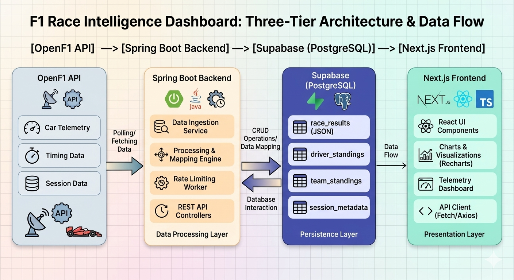

# 🏎️ F1 Race Intelligence Dashboard

An interactive full-stack Formula 1 analytics dashboard. Explore race weekends, compare drivers and constructors, dig into strategy and pace, and ask an AI analyst why a race went the way it did. Built on the [OpenF1 API](https://openf1.org/) and stored in PostgreSQL.

## 🌐 Live Demo

[**f1-race-intelligence-dashboard.vercel.app**](https://f1-race-intelligence-dashboard.vercel.app/)

## ✨ Highlights

- **Race analysis:** results, official grid, position-by-lap charts, and an interactive race replay
- **Strategy & pace:** tyre stints, pit stop rankings, tyre degradation curves, and lap-time analysis
- **Comparisons & standings:** head-to-head driver and constructor comparisons, profiles, and a title-fight calculator
- **Season map & forecast:** an interactive world map of the calendar, with a weather forecast for the next race weekend
- **History:** circuit history and driver career statistics
- **🤖 AI Race Analyst:** a Gemini-powered chat that answers questions using the dashboard's own data
- **Installable PWA** with offline support

See the [frontend README](frontend/README.md) for the full feature list.

## 🧠 Architecture



1. **Ingestion:** the Spring Boot backend retrieves and normalizes Formula 1 data from OpenF1 on a schedule.
2. **Persistence:** processed data is stored in Supabase (PostgreSQL).
3. **Presentation:** the Next.js frontend reads the stored data and renders the charts and views.
4. **Extras:** Next.js route handlers add historical statistics (Jolpica), weather forecasts (Open-Meteo), and the AI analyst (Gemini).

## 🛠️ Tech Stack

| Layer        | Technologies                                                              |
| ------------ | ------------------------------------------------------------------------- |
| Frontend     | Next.js, React, TypeScript, Tailwind CSS, Shadcn UI, Recharts             |
| AI           | Google Gemini API (function calling)                                      |
| Backend      | Java, Spring Boot                                                         |
| Database     | PostgreSQL, Supabase                                                      |
| Data sources | OpenF1 (live and session data), Jolpica (history), Open-Meteo (forecasts) |
| Deployment   | Vercel (frontend), Render (backend), cron-job.org (scheduled ingestion)   |

## 🗂️ Project Structure

```text
f1-race-intelligence-dashboard/
├── frontend/    # Next.js app: dashboard, API routes, AI analyst  → frontend/README.md
└── backend/     # Spring Boot app: data ingestion and sync         → backend/README.md
```

## 🚀 Roadmap

- ✅ **Phase 1 — Frontend Dashboard UI:** component architecture, mock data, responsive layout
- ✅ **Phase 2 — Backend Development:** OpenF1 integration, data processing
- ✅ **Phase 3 — Full-Stack Integration:** frontend/backend connection, state management, loading states
- ✅ **Phase 4 — Persistent Data Layer:** Supabase/PostgreSQL storage for historical data
- ✅ **Phase 5 — Advanced Analytics:** driver profiles and tyre strategy visualizations
- ✅ **Phase 6 — Race & Season Insights:** position-by-lap charts, title-fight calculator, pit crew ranking
- ✅ **Phase 7 — AI F1 Race Analyst:** Gemini-powered assistant with tool calling over the dashboard's data
- ✅ **Phase 8 — History & Planning:** constructor comparison, tyre degradation, circuit history, career statistics, weather forecast, season map

## 🚀 Getting Started

Run the backend and frontend separately. Setup, environment variables, and commands are in each folder:

- [Backend setup](backend/README.md#-local-development)
- [Frontend setup](frontend/README.md#-local-development)

## 📌 Data Sources & Credits

- **[OpenF1 API](https://openf1.org/):** session, timing, race-control, weather, and championship data
- **[Jolpica F1](https://github.com/jolpica/jolpica-f1):** historical results for career statistics and circuit history
- **[Open-Meteo](https://open-meteo.com/):** weather forecasts
- **[Natural Earth](https://www.naturalearthdata.com/):** world map outlines

This project is not affiliated with Formula 1 or the FIA.
