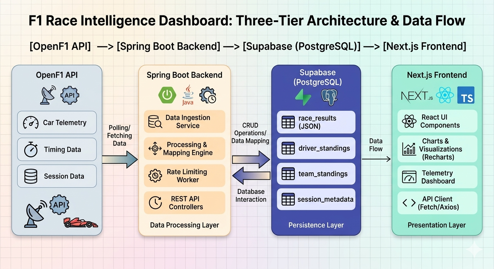

# 🏎️ F1 Race Intelligence Dashboard

An interactive full-stack Formula 1 analytics dashboard that brings live and historical race data together. Explore race weekends, compare driver and constructor performance, and uncover insights across sessions with data powered by the [OpenF1 API](https://openf1.org/) and stored in PostgreSQL.

## 🌐 Live Demo

[**f1-race-intelligence-dashboard.vercel.app**](https://f1-race-intelligence-dashboard.vercel.app/)

## ✨ Features

### Race Weekend & Session Analysis
- Session results and classification, including Sprint and Grand Prix sessions
- Weather conditions and race-control events
- Official starting grid, qualifying positions, and finishing positions, accounting for penalties
- Position-by-lap charts with safety car periods highlighted

### Strategy & Performance
- Tyre stint and pit stop analysis
- Pit stop leaderboard and team pit crew rankings by median stop time
- Lap time heatmaps, pace charts, sector times, and speed analysis
- Driver pace consistency insights

### Driver, Constructor & Championship Insights
- Driver and constructor profile pages
- Season form and championship points progression
- Head-to-head driver comparisons
- Driver and constructor standings
- Title-fight calculator showing championship contenders and remaining points

### Persistent Historical Data
- Historical data backfilled and stored by meeting in Supabase PostgreSQL
- Database-backed dashboard queries to reduce repeated upstream API calls
- Data ingestion and normalization handled by the Spring Boot backend

## 🧠 Architecture



The application is split into a Next.js frontend and a Spring Boot backend:

1. **Data ingestion** — Spring Boot services retrieve and normalize Formula 1 data from OpenF1.
2. **Persistence** — Processed data is stored in Supabase (PostgreSQL) for historical access.
3. **API layer** — Spring Boot exposes REST endpoints for dashboard features.
4. **Presentation** — Next.js fetches backend data and renders interactive charts and views.

## 🛠️ Tech Stack

| Layer | Technologies |
| --- | --- |
| Frontend | Next.js, React, TypeScript, Tailwind CSS, Shadcn UI, Recharts |
| Backend | Java, Spring Boot, Spring Web |
| Database | PostgreSQL, Supabase |
| Data source | OpenF1 API |
| Deployment | Vercel (frontend), Render (backend) |
| Data ingestion scheduling | cron-job.org |

## 🗂️ Project Structure

```text
f1-race-intelligence-dashboard/
├── frontend/    # Next.js dashboard, UI components, and API service layer
└── backend/     # Spring Boot application, data models, ingestion, and REST controllers
```

## 🚀 Roadmap

- ✅ **Phase 1 — Frontend Dashboard UI:** Component architecture, mock data, and responsive layout
- ✅ **Phase 2 — Backend Development:** OpenF1 integration, data processing, and REST endpoints
- ✅ **Phase 3 — Full-Stack Integration:** Frontend/backend connection, state management, and loading states
- ✅ **Phase 4 — Persistent Data Layer:** Supabase/PostgreSQL storage for historical data
- ✅ **Phase 5 — Advanced Analytics:** Driver profiles and historical tyre strategy visualizations
- ✅ **Phase 6 — Race & Season Insights:** Position-by-lap charts, title-fight calculator, and pit crew ranking
- 🔜 **Phase 7 — AI F1 Race Analyst:** A conversational AI assistant that answers natural-language questions about race results, driver comparisons, standings, and performance insights using dashboard data

### 🤖 Planned: AI F1 Race Analyst

The next planned feature is an AI assistant integrated into the dashboard. Users could ask questions such as:

- “Compare Verstappen and Norris in the 2025 season.”
- “Who had the most consistent pace in this race?”
- “Summarize the key moments of the Singapore Grand Prix.”
- “How does the constructor championship look after this round?”

The assistant would use tool/function calling to retrieve relevant information from the existing Spring Boot REST API and PostgreSQL data, then provide concise, data-grounded explanations. It is intended to complement the dashboard’s charts and analytics—not replace them.

> **Status:** Planned. The AI assistant is not implemented yet.

## 💻 Local Development

### Prerequisites

- Java and Maven (or use the included Maven Wrapper)
- Node.js and npm
- Supabase project credentials

### Backend

1. Navigate to the backend directory:
   ```bash
   cd backend
   ```
2. Configure the following environment variables (for example, in a `.env` file or your environment):

   ```env
   SUPABASE_URL=your_db_url
   SUPABASE_USERNAME=your_username
   SUPABASE_PASSWORD=your_password
   SPRING_PROFILES_ACTIVE=dev
   ```

3. Start the Spring Boot server:
   ```bash
   ./mvnw spring-boot:run
   ```

   The backend runs on port `8080`.

### Frontend

1. Navigate to the frontend directory:
   ```bash
   cd frontend
   ```
2. Create a `.env.local` file:
   ```env
   NEXT_PUBLIC_API_URL=http://localhost:8080
   NEXT_PUBLIC_SUPABASE_URL=your_supabase_url
   NEXT_PUBLIC_SUPABASE_ANON_KEY=your_supabase_key
   ```
3. Install dependencies and start the development server:
   ```bash
   npm install
   npm run dev
   ```

## ⚙️ Hosting & Data Constraints

### OpenF1 API

During active race sessions, the public OpenF1 API may rate-limit historical requests or restrict unauthenticated global access. The dashboard mitigates repeated requests by persisting ingested data in PostgreSQL and serving historical information from the database.

### Free-tier hosting

- **Backend (Render):** The free-tier service may spin down after inactivity, resulting in a cold-start delay of approximately 5–10 seconds on the first request.
- **Frontend (Vercel):** The frontend is deployed on Vercel; data-dependent views still rely on the backend response.
- **Scheduled ingestion:** Render's free tier does not reliably support persistent background workers while the service is spun down. An external cron-job.org webhook is configured to trigger selected ingestion endpoints during a weekend race-session window.

## 📌 Data Source

Race data is provided by the [OpenF1 API](https://openf1.org/). The dashboard uses its session, timing, race-control, weather, and championship data to power the analytics and visualizations.
